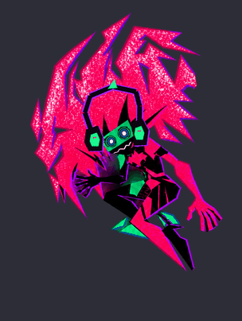
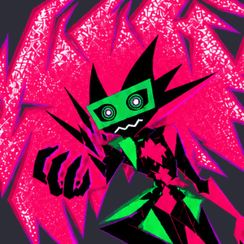

# Capri — desktop companion

A little Capri from *Cyberpunk: Edgerunners 2* who lives on your Windows desktop. She floats around, sits on your windows, chases your cursor, bobs her head to your music, reminds you of things, plays games and talks back (optionally).

 

## Download

**[⬇ Download Capri-Companion.zip](https://github.com/Zalipitok/zal-capri-pet/releases/latest/download/Capri-Companion.zip)** (latest release)

1. Unzip it anywhere, for example your Desktop.
2. Run **Capri.exe**. If Windows SmartScreen warns you, click *More info → Run anyway* (the exe isn't code-signed).
3. She appears near the bottom right. Right-click her for everything; she also has a tray icon next to the clock.

Needs Windows 10 (1809 or newer) or Windows 11. Nothing to install: she's a small native app (.NET Framework 4.8, already part of Windows) and stays light even on older PCs. Updates: she checks once a day and can install new versions herself (*right-click → Debug and help → Install update*).

> Voice clips aren't included (they're recorded from the show and not ours to share). She works fine without them: text bubbles instead of her voice, and chat replies can be read aloud by a Windows voice.

## What she does

- **Lives on your screen** — wanders, perches on the taskbar and on window title bars, rides along when you move a window (drag and drop her onto a title bar to make her sit there), works across multiple monitors and hides for fullscreen games.
- **Plays with you** — drag her around, throw her (she bounces), pat her (Ctrl-click), swat her (Shift-click), play *catch me*, throw her a toy ball to fetch, and call her over with **Ctrl+Alt+C**.
- **Notices things** — headphones and head-bobbing on the real beat of whatever is playing, battery reactions on laptops, optional weather reactions, quiet corner during Do Not Disturb / Focus, and (opt-in) which kind of app you're using.
- **Helps a bit** — reminders, a focus timer with streaks, sticky notes, break reminders.
- **Her powers** — possesses a window for a moment (opt-in), upgrades your cursor with a glitch trail, peeks out from behind windows.
- **Talks** — a chat window with games (rock paper scissors, guess the number, trivia). With your own [Claude API key](https://console.anthropic.com) she replies in character, read aloud by a Windows voice.
- **Remembers** — days together, head pats, throws, high scores, and unlocks new routines as you go.
- **Invite a friend** — a second, recoloured Capri who visits, chats with her, plays tag and dances.
- **Stays out of your way** — *Stay here* keeps her in one spot, *Let clicks through her* makes her click-through, and she moves off the window you're working in.
- **Little sounds** — her own synthesized sound effects for pats, swats, clicks, throws, landings, sitting, peeking and more.

Everything is in *Settings* (right-click → Settings window…). `README.txt` in the download is a short guide.

## Privacy

No telemetry. Nothing leaves your PC unless you turn it on:
- **Weather** sends your city name to [open-meteo.com](https://open-meteo.com).
- **Chat replies** send what you type (plus the time, the song playing and your history with her) to Anthropic, using your own key, which is stored encrypted for your Windows account.
- **Update check** asks GitHub for the latest version number.

Beat detection listens to your PC's sound in memory only; nothing is recorded or saved.

## For tinkerers

Behaviour, lines, tuning, unlocks and trivia are plain JSON files next to the exe (`behaviours.json`, `remarks.json`, `tuning.json`, `unlocks.json`, `games.json`). The code is C# (WPF, .NET Framework 4.8) in `src\Capri`; GitHub Actions builds it on every push. `Run-SelfTest.bat` checks everything and writes `selftest-report.txt`. The drawings' talking, headphone and facing data come from `tools/make_style2_variants.py`; the sound effects from `tools/make_sfx.py`. Pushing to the `release` branch builds a new release (version from `VERSION`).

---

Fan-made and unofficial. Not affiliated with or endorsed by CD PROJEKT RED, Studio Trigger or Netflix. Capri and *Cyberpunk: Edgerunners* belong to their respective owners.
